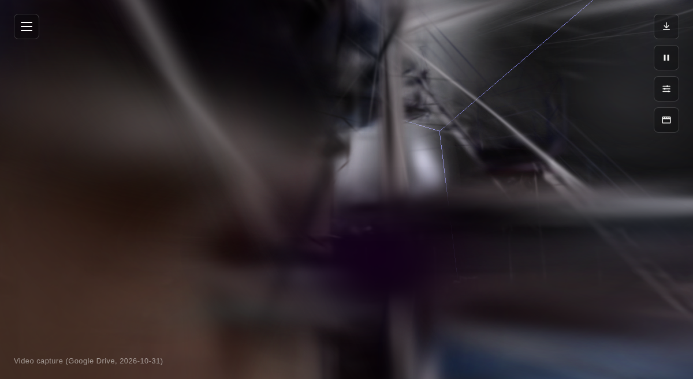

# Gaussian Splatting Pipeline

End-to-end pipeline: **video -> trained 3D Gaussian Splat -> browser viewer**,
running entirely on a single consumer GPU (tested on an RTX 3050, 6GB VRAM).

Built on top of the original [graphdeco-inria/gaussian-splatting](https://github.com/graphdeco-inria/gaussian-splatting)
training code, with:
- a parameterized end-to-end shell pipeline (video -> frames -> COLMAP ->
  trained `.ply`)
- a lightweight static web viewer (Three.js + [mkkellogg/GaussianSplats3D](https://github.com/mkkellogg/GaussianSplats3D))
  that serves a gallery of splats from a single `manifest.json`, with
  crossfade transitions between scenes
- a Docker/nginx setup to serve the gallery

## Test subject used throughout this README

All examples below use **`video-splat-gdrive-20261031`** as the reference
scene — a ~700-frame indoor video capture, trained to a ~101,000-Gaussian
point cloud. It's intentionally a "normal" dense scene (not a cherry-picked
easy case), so the example reflects realistic output quality on this
hardware.


*Rendered directly from the browser viewer — real output, not a mockup.*

## Requirements

- NVIDIA GPU with CUDA (tested on RTX 3050, 6GB VRAM — the training script
  is tuned for this budget; see "VRAM tuning" below for larger GPUs)
- [COLMAP](https://colmap.github.io/) (structure-from-motion, used for
  camera pose estimation)
- `ffmpeg` (frame extraction)
- Python environment with PyTorch + CUDA, `diff-gaussian-rasterization` and
  `simple-knn` submodules built (see the original
  [gaussian-splatting install instructions](https://github.com/graphdeco-inria/gaussian-splatting#setup))
- Docker + Docker Compose (only needed for the viewer gallery container)

This repo assumes you already have a working `gaussian-splatting` training
environment (its `train.py` is called directly by `run_pipeline.sh`) — it
does not vendor the training code itself, only the pipeline/viewer glue.

## Usage

### 1. Train a splat from a video

```bash
scripts/run_pipeline.sh <video.mp4> <project_dir> <splat_id> "<Splat Label>" <fps>
```

Example (the actual command used for this README's reference scene):

```bash
scripts/run_pipeline.sh \
  ~/Downloads/some_video.mp4 \
  ~/projects/gaussian-splatting/video-splat-gdrive-20261031 \
  video-splat-gdrive-20261031 \
  "Video capture (Google Drive, 2026-10-31)" \
  8
```

This runs, in order:
1. `ffmpeg` frame extraction at the given fps
2. COLMAP feature extraction (capped at 1280px max image size — avoids GPU
   OOM on 6GB cards)
3. COLMAP sequential matching
4. COLMAP mapper (sparse reconstruction)
5. Automatic selection of the largest reconstructed submodel (COLMAP can
   produce multiple disconnected submodels on textureless/repetitive
   scenes — the script picks the one with the most registered images)
6. Undistort
7. Training (7000 iterations, `--resolution 4`, gentle densification
   thresholds tuned for 6GB VRAM)
8. Registers the resulting point cloud into the viewer gallery

Expect roughly 10-30 minutes end-to-end on a 6GB GPU depending on video
length and scene complexity.

### VRAM tuning

If you have more VRAM available, you can safely increase quality:
- `--resolution 4` -> `--resolution 2` or `1` (full resolution) in the
  `train.py` call inside `scripts/run_pipeline.sh`
- `--FeatureExtraction.max_image_size 1280` -> higher, in the COLMAP
  feature extraction step
- Relax `--densify_grad_threshold` / widen `--densify_until_iter` for
  denser final point clouds

### 2. Register an already-trained `.ply` without re-running the pipeline

```bash
scripts/add_splat.sh <path/to/point_cloud.ply> <splat_id> "<Splat Label>"
```

This converts the `.ply` to the compressed `.ksplat` format, copies it
into `viewer/splats/`, and appends an entry to `viewer/manifest.json`.

### 3. Run the viewer gallery

```bash
docker compose up -d --build
```

Serves the gallery at `http://localhost:8909/`. The viewer reads
`manifest.json` at load time — no rebuild needed to add new splats, just
re-run `add_splat.sh` and restart the container (`docker compose up -d --build`
picks up new files baked into the image; for a live-reload setup, mount
`viewer/` as a volume instead).

Each entry in `manifest.json`:

```json
{ "id": "video-splat-gdrive-20261031", "label": "Video capture (Google Drive, 2026-10-31)" }
```

## Repo layout

```
scripts/
  run_pipeline.sh    # video -> trained .ply, parameterized
  add_splat.sh        # register an existing .ply into the viewer
viewer/
  index.html, gallery.js, styles.css   # the static gallery frontend
  lib/                 # vendored Three.js + GaussianSplats3D (MIT licensed)
  manifest.example.json
examples/
  video-splat-gdrive-20261031.png   # reference output, see above
docker-compose.yml, Dockerfile, nginx.conf   # serving setup
```

## Related: style transfer

See [github.com/n2048-creative-technology/sgsst-splat-style-transfer](../sgsst-splat-style-transfer)
for an SGSST-based artistic style transfer pipeline that operates on
splats trained with this repo.

## License

- `scripts/`, `viewer/gallery.js`, `viewer/index.html`, `viewer/styles.css`,
  Docker/nginx config: original work by the repo author, MIT License (see
  `LICENSE`).
- `viewer/lib/three.module.js`: [Three.js](https://threejs.org/), MIT
  License.
- `viewer/lib/gaussian-splats-3d.module.js`: [mkkellogg/GaussianSplats3D](https://github.com/mkkellogg/GaussianSplats3D),
  MIT License.
- The underlying Gaussian Splatting training code
  ([graphdeco-inria/gaussian-splatting](https://github.com/graphdeco-inria/gaussian-splatting))
  is **not** included here and is licensed separately (research/non-commercial
  use) — see their repository for terms.
